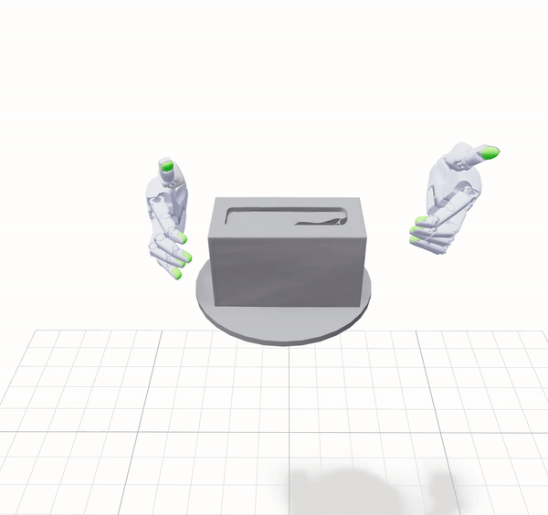
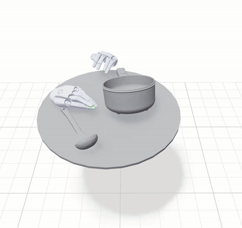
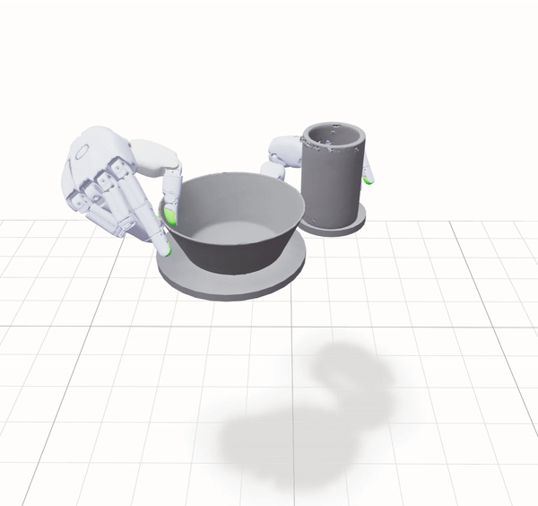

# Uni-FlashCHORD

**原始实现：** [NVIDIA FlashCHORD](https://github.com/nvidia-isaac/video_to_data/tree/main/robotic_grounding/flash_chord) · **语言：** [English](README.md) | 简体中文

<p>
  
  
  
</p>

Uni-FlashCHORD 是基于 **UniLab + UniSim Newton** 独立复现的 FlashCHORD 灵巧手参考重定向与跟踪项目。它将 ManoSharpaData 参考序列加载到悬浮双 Sharpa 手与物体场景中，使用 FlashSAC 训练参考跟踪策略，并提供物理 replay 和 checkpoint 可视化。

**[安装](#安装) → [示例数据](#示例数据) → [Replay](#replay) → [训练](#训练) → [训练结果](docs/training_results_zh.md) → [评估](#评估)**

## 功能

- 直接读取 parquet 参考数据，在运行时解析物体、支持面和碰撞资产，包括 CoACD 分解；
- 使用 4096 个 Newton 并行环境，20 Hz 控制、100 Hz 物理；
- 通过异步 Torch FlashSAC、n-step replay、VOC 课程和 checkpoint 恢复进行训练；
- 支持 `kinematic`、`voc0`、`voc1` 三种 replay 模式；
- 使用确定性动作和参考序列自动循环 reset，在 Viser 中可视化 checkpoint。

## 安装

要求：

- Linux 和支持 Newton 的 NVIDIA CUDA 环境；
- Python 3.11–3.13；
- [uv](https://docs.astral.sh/uv/) 和 Git LFS；
- 默认训练配方建议使用 48 GiB 级 GPU。

```bash
git clone https://github.com/unilabsim/Uni-FlashCHORD.git
cd Uni-FlashCHORD
git lfs pull
uv sync
```

Git LFS 用于下载仓库自带的 parquet、Sharpa mesh 和其他资产。uv 会安装正式发布的 UniLab 1.5.3 和 UniSim 2.2.4 依赖，无需手动克隆其他仓库。

可视化入口默认使用 `http://localhost:8080`。远程运行时请通过 SSH 转发该端口。关闭浏览器标签页不会停止服务，请在终端按 **Ctrl+C** 退出后再启动下一个 viewer。

## 示例数据

仓库自带完整的 `tissue_box_simple` 参考序列和配套资产。在仓库根目录设置：

```bash
PARQUET="$PWD/data/assets/human_motion_data/ego_recon/processed/sequence_id=tissue_box_simple/robot_name=sharpa_wave"
```

后续 replay、训练和评估命令都复用该变量。使用其他序列时，将其改为包含目标 parquet 的目录：

```bash
PARQUET="/absolute/path/to/robot_name=sharpa_wave"
```

Uni-FlashCHORD 直接消费 **ManoSharpaData parquet 及配套 URDF、mesh 和支持面资产**。资产转换和 CoACD 缓存会在运行时自动完成，不需要把大数据集处理脚本复制到本仓库。

如果只有原始视频、动捕或重建输出，请先通过外部 `video_to_data/robotic_grounding` 管线生成 parquet 和资产。数据生产由该管线负责，Uni-FlashCHORD 负责训练、replay 和评估。

## Replay

```bash
uv run python scripts/replay.py "task.parquet='$PARQUET'" mode=voc1
```

打开 `http://localhost:8080` 并开始播放。可选模式：

- `kinematic`：逐帧显示参考状态，不进行物理积分；
- `voc0`：启用碰撞，关闭物体 VOC wrench 和 articulation drive；
- `voc1`：启用完整 VOC。

Viser 提供播放、重启、进度和倍速控制。追加 `record.output=/tmp/replay.npz` 可记录公开状态与控制量。

## CUDA MPS 设置

推荐的训练路径使用 CUDA MPS 在 collector 和 learner 之间共享 GPU。Linux 单 GPU 环境请在训练前启动 daemon 并导入其环境变量：

```bash
uv run uni-cumps start --gpus 0 --name chord-mps --daemon
eval "$(uv run uni-cumps env --name chord-mps --shell posix)"
```

MPS daemon 由用户显式管理。训练结束后停止自己创建的 daemon：

```bash
uv run uni-cumps stop --name chord-mps
```

## 训练

```bash
uv run python -m chord_unilab.scripts.train_flashsac \
  task=sharpa_chord/newton \
  "env.scene.reference_path='$PARQUET'" \
  training.no_play=true \
  training.cuda_process_sharing=mps
```

这是完整的**约 250M environment-step** 配方，默认使用 4096 个并行环境，每次训练一个参考序列。切换数据只需修改 `PARQUET`，无需增加数据集专用 YAML 或 Hydra searchpath。

checkpoint 每 2500 iterations 保存一次：

```text
logs/flash_sac/SharpaChordFlashSAC/<run>/model_<iteration>.pt
```

## 评估

```bash
CHECKPOINT="/absolute/path/to/model.pt"

uv run python scripts/evaluate.py \
  --parquet "$PARQUET" \
  --checkpoint "$CHECKPOINT"
```

评估只显示 1 个环境。策略从参考帧 0 开始，VOC=0 且无 settling；到达参考序列末尾后自动 reset 并循环播放。

绿色半透明 mesh 表示当前参考帧中的双手和物体，正常渲染的 mesh 表示实际策略仿真状态。该虚影只用于显示，不影响物理状态或策略动作。

- 使用 Viser 暂停或单步控制检查行为；
- 使用 `--port` 修改端口；
- 按 **Ctrl+C** 退出；checkpoint 缺失时会直接报错，不会回退到零动作。

该入口用于确定性策略可视化，不启动训练，也不计算 MPPE、ADD-AUC 等聚合指标。

## 配置

| 内容 | 位置 |
| --- | --- |
| 场景、观测、动作、奖励、reset 和 termination | `src/chord_unilab/conf/flashsac/task/sharpa_chord/base.yaml` |
| Newton、4096 环境和 FlashSAC 配方 | `src/chord_unilab/conf/flashsac/task/sharpa_chord/newton.yaml` |
| 训练、日志和 Viser 默认值 | `src/chord_unilab/conf/flashsac/config.yaml` |
| 数据格式和重采样语义 | `src/chord_unilab/data/README.md` |
| 资产解析、转换和缓存 | `src/chord_unilab/assets/README.md` |

覆盖配置时直接在训练命令后追加 `key=value`，例如：

```bash
algo.seed=123 training.wandb_name=tissue_seed_123
```

## 开发

```bash
make check      # Ruff、format、mypy、pyright
make test       # 完整测试，要求 Git LFS 资产
make test-fast  # 跳过真实 Newton 集成测试
```

真实 Newton 测试默认使用仓库内纸巾盒数据，也可用 `CHORD_TISSUE_PARQUET` 覆盖。

## License

Apache License 2.0。第三方代码来源见 `THIRD_PARTY_NOTICES`。
