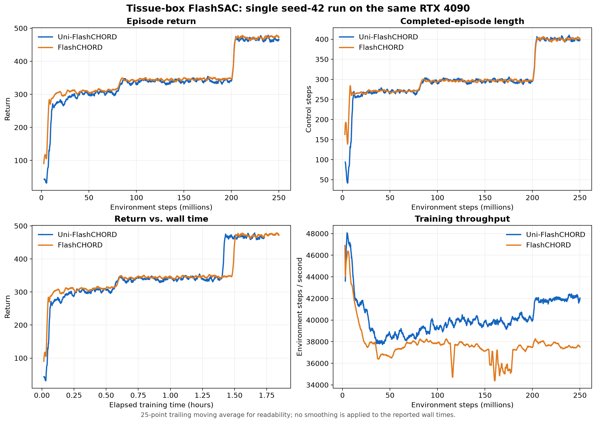
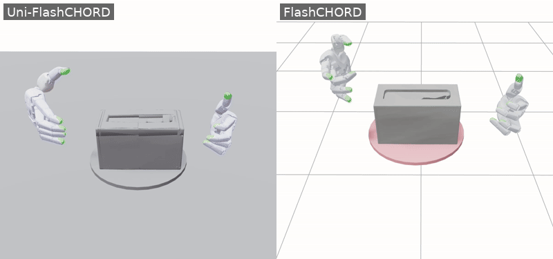

# Training results

**Language:** English | [简体中文](training_results_zh.md) · [Back to README](../README.md)

## Tissue-box training comparison

The following measurements compare one complete tissue-box run per implementation on the **same RTX 4090**, using seed 42, 4096 environments, and approximately 250M environment steps. The Uni-FlashCHORD run used CUDA MPS and deferred contact publication; FlashCHORD used its upstream JAX training path. These are end-to-end implementation measurements, not a controlled ablation of either optimization.

| Measurement | Uni-FlashCHORD | FlashCHORD |
| --- | ---: | ---: |
| Environment steps | 249,999,360 | 250,003,456 |
| Training span, first-to-last scalar | 1 h 43 min 51 s | 1 h 50 min 40 s |
| Mean throughput over that span | 40,039 env steps/s | 37,635 env steps/s |
| Final logged episode return | 493.81 | 460.51 |
| Final logged completed-episode length | 420.53 control steps | 390.90 control steps |

Wall times come from TensorBoard scalar timestamps. Mean throughput is environment steps divided by that same span; the final return and episode length are the last logged values rather than multi-seed averages. Curves below use a 25-point trailing moving average only for readability.

This is a single-run comparison, not evidence of statistical significance or a claim of exact numerical equivalence with the reference implementation.

## Final-policy visualization

Both GIF panels show deterministic, single-environment Viser rollouts from the final checkpoints above, with the same tissue-box reference and camera. They are qualitative examples, not aggregate evaluation metrics.

